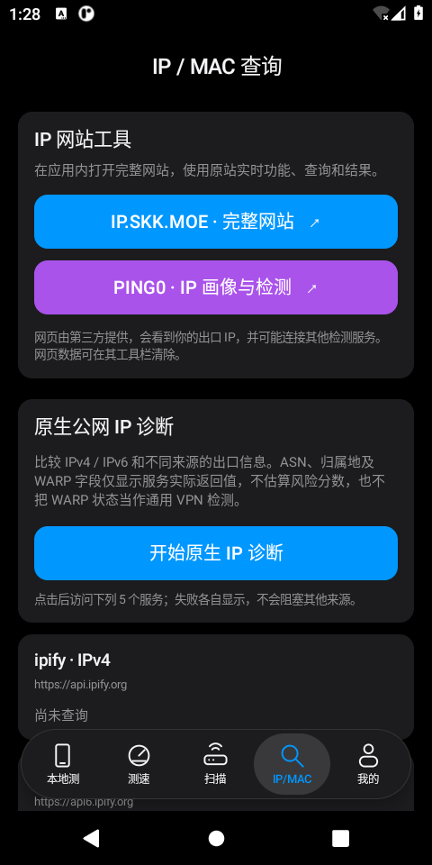
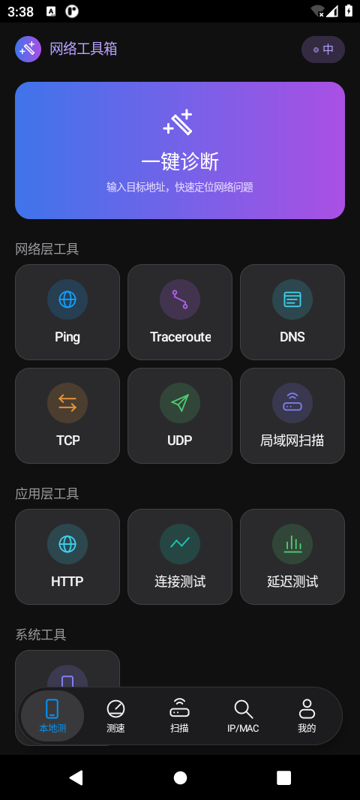
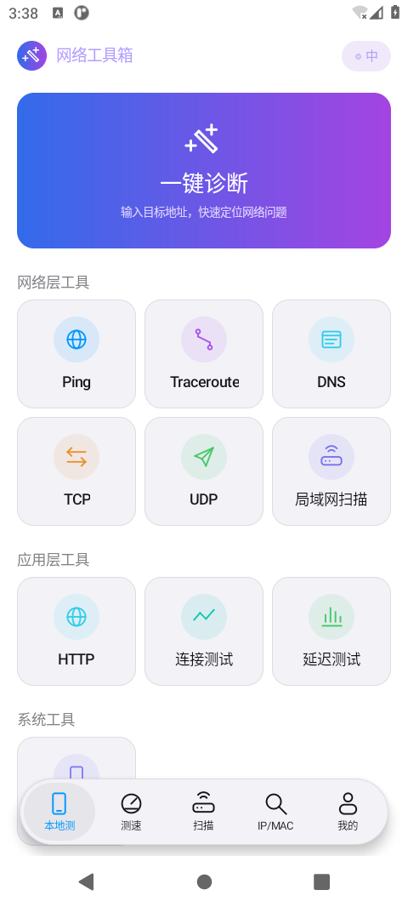
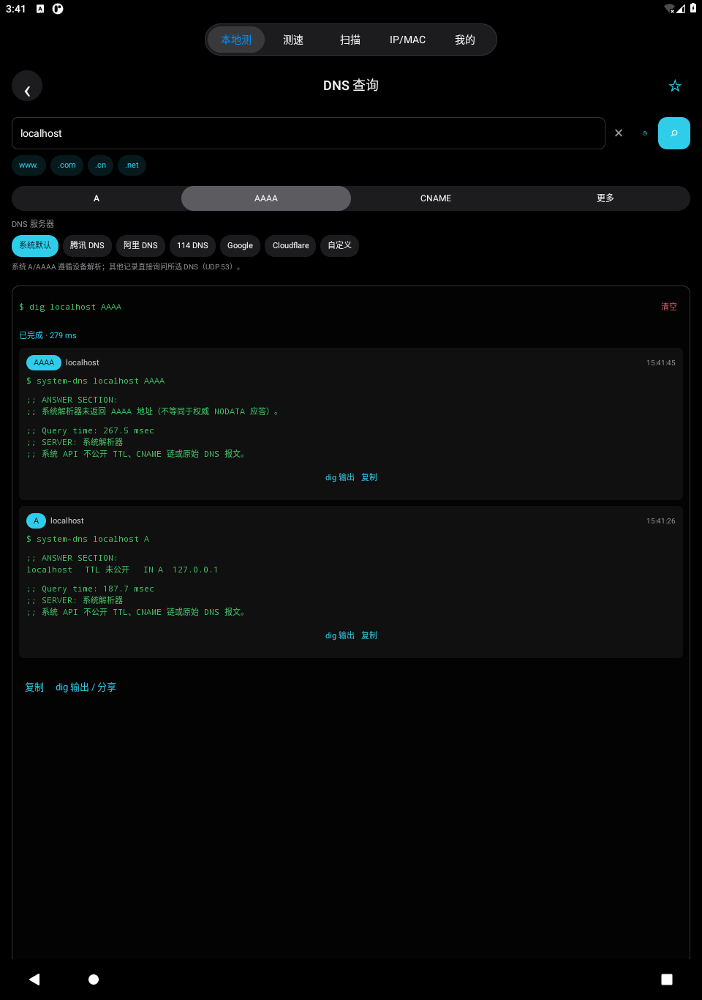
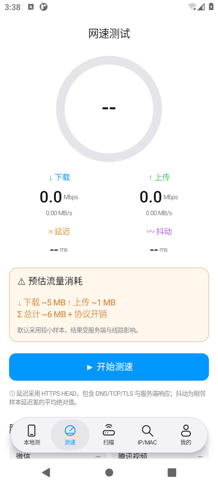
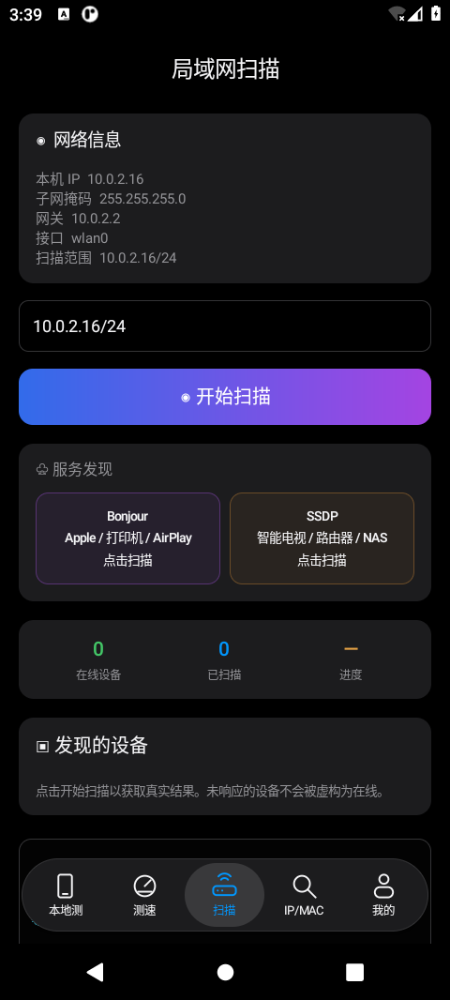
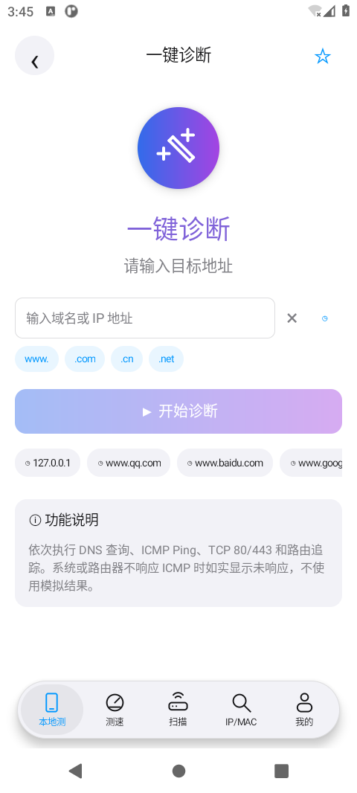

# 网络工具箱 · Network Toolkit

原生 Android 网络工具应用，支持 Android 8.0+。当前开发版本 **1.2.0** 增加原生多来源 IP 诊断、应用内 ip.skk.moe / ping0.cc 网站工具和蓝白原创图标。原生工具无需账号，不含广告或分析 SDK；第三方网页可能有自己的广告、账号、收费服务与隐私规则。

## 下载与界面

- [下载 1.2.0 预览 APK（开发测试签名）](dist/network-toolkit-1.2.0-debug.apk?raw=true)
- [1.1.0 正式 GitHub Release](https://github.com/vmlive/Network-Toolkit/releases/tag/v1.1.0)
- [下载 1.1.0 APK（开发测试签名）](https://github.com/vmlive/Network-Toolkit/releases/download/v1.1.0/network-toolkit-1.1.0-debug.apk)
- [安装包与 SHA-256 校验](dist/)
- [实际测试记录与未验证范围](docs/VALIDATION.md)

1.2.0 为新增功能的预览版本，**没有替换或重新发布 1.1.0 正式 Release**。签名、构建与实际测试结果统一见 [VALIDATION.md](docs/VALIDATION.md)。以下截图来自本项目运行结果；参考来源与尚未核对的部分见 [参考说明](docs/REFERENCE.md)。

### 1.2.0 新功能与图标

 

网页截图展示当前云网络受限时的原生失败提示，不是已加载的站点内容；真实站点的端到端验证仍待网络允许或实际手机确认。

 

### 1.1.0 界面留档

 

 

 

[查看平板首页](docs/screenshots/v1.1-tablet-home.png)

仓库 APK 均为开发测试签名版本。下载安装时需允许相应来源安装应用；正式渠道发行应使用开发者长期保管的 release 签名密钥。旧版 1.0.0 / 1.1.0 APK 保留在 `dist` 供对照。

## 1.2.0：原生 IP 诊断与完整网站

“IP/MAC”分区和首页“IP 与网络画像”分类提供三项新增入口，按用户确认的“原生 IP 诊断 + 应用内完整网站”方案实现：

- **公网 IP 诊断**：主动查询 ipify IPv4、ipify IPv6、IP.SB、Cloudflare Trace 和 Ping0 当前出口接口。每个来源单独报告返回字段、耗时或失败；支持停止，不把缺失信息填成默认结果。
- **IP.SKK.MOE / Ping0.cc**：在应用内加载两个原始 HTTPS 网站，使用原站页面、交互与实时服务。提供网页历史返回、刷新/停止、分享、系统浏览器入口和清除网站数据。
- **新图标**：采用原创蓝白网络 N 图形，支持 Android 自适应图标和 Android 13+ 单色主题图标。UISP App Store 页面未能读取，因此这是暂定的简洁网络应用风格设计，未声称与 UISP 最新图标精确一致，也未使用 Ubiquiti 的 U 标识。

原生诊断仅展示服务实际返回的 IP、地址族、位置、ASN、组织或 Trace 字段。不同来源的结果可能因双栈、路由、分流或数据库而不同，**差异不等于 VPN、泄漏或风险证据**；Cloudflare WARP 状态也不是通用 VPN 检测。Ping0 风险分数、原生 IP、机房 IP 等专有结果由原网站提供，原生实现没有付费 API Key，也不会推算或补造这些字段。

两个网站、其接口及 UISP App Store 页面在当前云环境被网络策略返回 403，无法核对其最新完整功能或完成实时外网验证。Ping0 `/geo` 四行接口来自可读取的第三方公开资料，当前官方协议与可用性未确认；接口失败会明确显示，可使用完整网站或系统浏览器。应用内网站需要可用的 Android System WebView/Chrome，某些站点登录、验证码或浏览器能力可能需要系统浏览器；没有通过关闭 TLS 验证来掩盖加载问题。

## 界面与工具

应用统一为“本地测、测速、扫描、IP/MAC、我的”五个入口：手机使用底部浮动分段导航，平板使用顶部导航。首页包含蓝紫渐变“一键诊断”、三列分类工具、圆形彩色图标，支持深浅主题。详情页提供快捷域名后缀、最近目标、终端式结果、复制与分享；“我的”保留全部工具搜索、收藏和本机历史。

当前工具目录共 **29 项**（1.1.0 的 26 项，加上原生公网 IP 诊断和两个网站入口）：

| 功能 | 实际行为 |
| --- | --- |
| 一键诊断 | 顺序执行 DNS、真实 ICMP Ping、TCP 80/443 和路由追踪，分别报告结果或错误 |
| Ping / Traceroute | 调用 Android 系统 ICMP 探测；支持包数、IPv4/IPv6 选择；Traceroute 递增 TTL，未响应节点显示 `*` |
| DNS 查询 | A、AAAA、CNAME、MX、TXT、NS、SOA、PTR；系统、腾讯、阿里、114、Google、Cloudflare 或自定义 DNS；查询记录卡片与 dig 风格文本输出 |
| TCP 延迟 / 连接测试 / 端口检测 | 实际 TCP 握手；端口扫描最多 128 个端口、16 并发；不会当作 ICMP Ping |
| UDP | 向指定目标发送文本数据包并等待响应；无响应不等于端口关闭 |
| 局域网扫描 | 本机地址、掩码、网关、扫描进度及真实响应设备；范围限私有或链路本地 IPv4 CIDR，最多 256 个地址 |
| Bonjour / SSDP | Android NSD 服务发现，以及局域网 UPnP M-SEARCH；显示收到的服务信息 |
| 网速测试 | 实际 HTTPS 下载、上传、5 次 HEAD 响应延迟与抖动；默认约 5 MB 下载 + 1 MB 上传，开始前明确确认流量；可选 10/20 MB 下载样本 |
| 分类站点延迟 | 26 个 AI、社交、视频、游戏、电商、云服务站点，HTTPS HEAD 实测，最多 6 并发；可单独检测、添加或删除自定义站点 |
| HTTP / TLS 证书 | GET 状态、响应头、最多 64 KiB 正文预览；HTTPS 证书链、有效期、指纹及系统信任验证 |
| IP/MAC / 公网 IPv4 | 地址解析、分类、可用反向 DNS；MAC 格式、OUI 前缀、单播/组播和本地管理标志；公网 IPv4 主动请求 ipify |
| 原生公网 IP 诊断 | 五来源出口查询与 IPv4/IPv6 区分，只展示实际返回的归属、ASN 或 Trace 字段；独立报告失败，不生成风险分数 |
| IP.SKK.MOE / Ping0.cc | 应用内原始 HTTPS 网站及完整网页交互；专有数据、登录和收费功能由原站管理 |
| 本机信息 | 当前连接、网络接口、地址、DNS、路由、系统与设备信息；受系统限制的信息保持未知 |
| 子网计算 / 远程唤醒 | IPv4 CIDR 规划（含 /0、/31、/32）；发送 WOL 魔术包，发送成功不代表目标已开机 |
| 编码与摘要 | 本机 Base64 编解码、URL 编解码、SHA-256、MD5；MD5 仅用于非安全性兼容校验 |

网络操作在后台执行，可停止；不使用截图中的示例数字冒充结果。Android 系统、路由器或目标服务可能限制 ICMP、多播、MAC 读取、端口或 HEAD 请求，失败和未响应会如实展示，不等于设备离线。IP、路由和 MAC 结果不附加猜测的地理位置、运营商或厂商。

### DNS 与测速语义

“系统默认”的 A/AAAA 查询使用 Android 解析器，可能受系统缓存和私密 DNS 设置影响。系统默认的其他记录类型使用当前网络提供的 DNS 服务器；选择公共或自定义服务器时，直接使用 **UDP 53** 查询，**不会继承 Android 私密 DNS / DoT，也不是 DoH**。公共 DNS 名称是服务器地址选项，不代表采用其加密协议；网络若阻断 UDP 53，应保留并检查实际错误。

测速中的延迟与分类站点延迟采用 HTTP HEAD，耗时包含 DNS、TCP、TLS 与服务端响应，不能等同 ICMP 延迟。抖动为相邻成功样本耗时差的平均绝对值。下载使用 GET、上传使用 POST，包含连接开销，默认小样本不保证测到线路峰值；失败阶段也可能产生部分流量，计费还包含协议和网络缓冲开销。可在“我的 → 测速设置”选择样本及 HTTPS 端点。

## 参考核对范围

1.1.0 可读取的素材为 **8 张图片，未见可读取的视频附件**，据此实现首页、DNS、扫描、分类延迟、Traceroute、一键诊断和测速布局，并统一图片中不同的导航。原图没有展开 IP/MAC、“我的”和所有交互状态，因此不宣称与原应用全部功能或每个像素一致。1.2.0 的网站与 UISP 参考页尚未获得实时读取和视觉核对；图标为原创生成素材，仓库界面截图来自本项目运行结果。详细对照见 [REFERENCE.md](docs/REFERENCE.md)。

## 本地开发

工具链：Android SDK Platform 35、Android Gradle Plugin 8.7.3、Gradle 8.9；云环境使用 JDK 21，最低运行版本 Android 8.0（API 26）。Gradle Wrapper 包含官方分发包 SHA-256 校验。

```bash
git clone https://github.com/vmlive/Network-Toolkit.git
cd Network-Toolkit
# 已安装 SDK 时设置 ANDROID_HOME，或使用本机 local.properties。
./gradlew testDebugUnitTest lintDebug assembleDebug
```

无 SDK 的 Linux x86_64 云环境可执行：

```bash
./scripts/bootstrap-android.sh
./scripts/cloud-gradle.sh testDebugUnitTest lintDebug assembleDebug
```

脚本从官方源下载并校验工具，不保存代理凭据。缓存默认位于 `/workspace/.toolchains`（无 `/workspace` 时使用用户缓存目录）。APK 输出为 `app/build/outputs/apk/debug/app-debug.apk`。直接使用既有 checkout；每个云任务已隔离，无需另建 Git worktree。

设备测试需要已经启动的 Android 模拟器或已连接设备：

```bash
./scripts/cloud-gradle.sh connectedDebugAndroidTest
```

构建、单元测试、设备测试和真机外网测试是不同结果；本次实际执行情况统一记录在 [VALIDATION.md](docs/VALIDATION.md)，不以构建成功替代设备验证。GitHub Actions 运行单元测试、Lint 和 APK 构建并上传 artifact，远端结果可在仓库 Actions 页面查看。

## 隐私与权限

应用仅声明 INTERNET、ACCESS_NETWORK_STATE、ACCESS_WIFI_STATE 和 CHANGE_WIFI_MULTICAST_STATE，不申请 GPS/位置、通讯录或存储权限。Wi-Fi 多播权限用于局域网服务发现，未支持的系统信息不会虚构。

公网 IP 原生查询使用 `api.ipify.org`、`api6.ipify.org`、`api.ip.sb/geoip`、`www.cloudflare.com/cdn-cgi/trace`、`ping0.cc/geo`；这些服务会看到出口 IP。默认测速使用 Cloudflare。分类站点与原生诊断均由你主动启动，其他工具连接输入目标、所选 DNS 或当前局域网。

内嵌网站允许 JavaScript、DOM 存储和第一方 Cookie，不提供 JavaScript 原生桥，不允许网页读取应用文件或获得相机、麦克风和 GPS 权限。网页 Cookie、登录状态及本地存储可能保留在应用私有 WebView 中；网页菜单“清除网站数据”可删除两个站点的本机浏览数据，原站账号数据与系统浏览器数据不在其删除范围。外部 HTTPS 链接须经用户操作确认后交给浏览器；危险协议、明文混合资源与证书错误均不会放行。详见 [PRIVACY.md](docs/PRIVACY.md)。

收藏、自定义站点、DNS 设置和历史仅在本机保存。历史最多 50 条、每条结果最多约 16 KiB，可能含网址参数、目标和输入文本，可关闭新增记录并清空；Android 备份和设备迁移已排除应用数据，卸载后删除本机数据。

## 代码结构

- `MainActivity.java`、`Tool.java`：原生界面、导航、工具目录、收藏、历史与异步执行。
- `DeviceTools.java`、`LanDiscovery.java`：Android 网络信息、公网 IP、局域网与服务发现。
- `Measurements.java`：实际下载/上传、HEAD 延迟与站点测量。
- `IpDiagnostics.java`：有界并发的多来源公网 IP 诊断、严格响应解析与独立错误结果。
- `WebToolsActivity.java`、`WebSitePolicy.java`：固定原站入口、安全网页导航、存储与浏览数据管理。
- `core/`：DNS 协议、ICMP/TTL 诊断、IP/MAC、TCP/HTTP、编码等逻辑。
- `app/src/test/`、`app/src/androidTest/`：JVM 及 Android 设备测试。
- `docs/VALIDATION.md`：验证证据、平台限制与未验证范围。

本项目采用 [MIT 许可证](LICENSE)。
