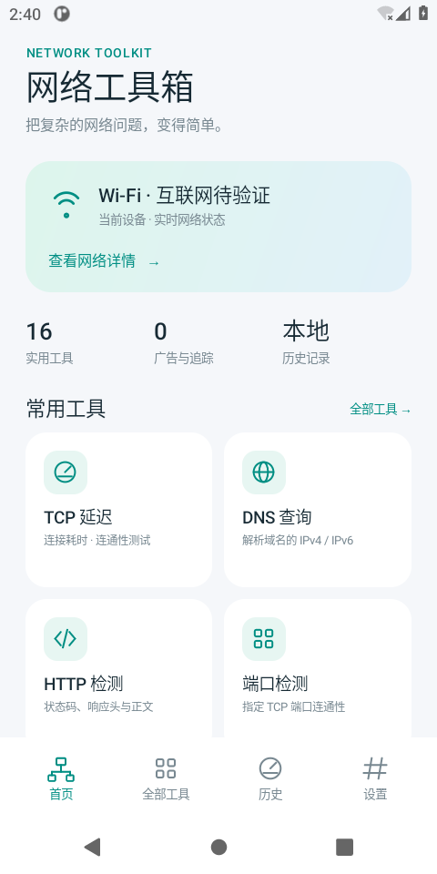
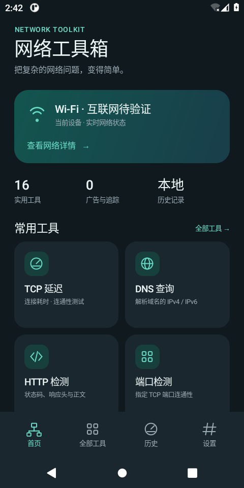
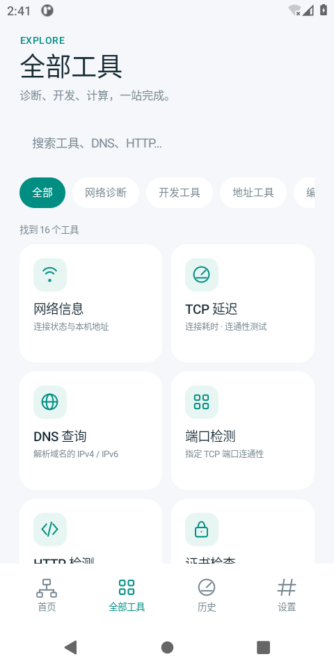
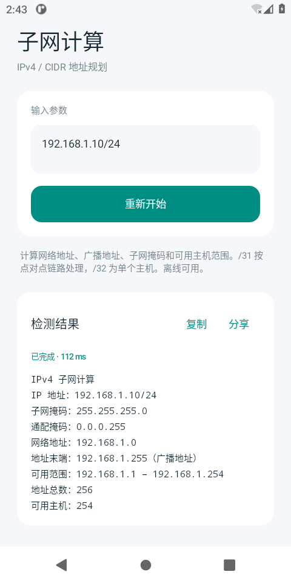

# 网络工具箱 · Network Toolkit

一个无需账号、无广告的原生 Android 网络工具应用。中文界面，支持深色模式、工具搜索与分类、收藏、最近 50 条本机历史、结果复制与系统分享。

## 实际界面

以下为 AOSP Android 11 模拟器实际运行截图，不是参考应用截图或设计稿。

 

 

## 下载与安装

仓库的 [`dist/`](dist/) 保存可安装 APK 及 SHA-256 校验文件。当前 APK 为开发测试签名版本，支持 **Android 8.0（API 26）及以上**。下载安装时需允许相应来源安装应用。它不是应用商店正式签名发行版；后续正式发行应使用开发者妥善保管的签名密钥。

## 已实现的工具

| 分类 | 工具 | 行为 |
| --- | --- | --- |
| 网络诊断 | 网络信息 | 当前连接、接口、地址、DNS、路由、计费状态 |
| 网络诊断 | TCP 延迟 | 4 次真实 TCP 握手，成功次数、最小/平均/最大耗时；不是 ICMP Ping |
| 网络诊断 | DNS 查询 | 系统解析器的 IPv4 / IPv6 结果 |
| 网络诊断 | 端口检测 | 指定主机最多 128 个 TCP 端口，并发最多 16 |
| 网络诊断 | 公网 IP | 用户主动请求 api.ipify.org |
| 网络诊断 | 下载测速 | HTTPS 实际下载；默认 5 MB，单次上限 10 MiB / 20 秒 |
| 开发工具 | HTTP 检测 | GET 状态、响应头、最多 64 KiB UTF-8 正文预览；不自动跳转 |
| 开发工具 | 证书检查 | 系统信任与主机名验证、证书链、到期时间、SHA-256 指纹 |
| 地址工具 | 子网计算 | IPv4 CIDR，包含 /0、/31、/32 边界情况 |
| 地址工具 | 远程唤醒 | UDP Wake-on-LAN 魔术包；发送不等于唤醒成功 |
| 编码工具 | Base64 编码 / 解码 | 本机 UTF-8 文本转换 |
| 编码工具 | URL 编码 / 解码 | UTF-8 表单参数规则，空格与 + 转换 |
| 编码工具 | SHA-256 / MD5 | 本机文本摘要；MD5 不用于安全场景 |

网络操作在后台执行，可取消。输入错误、网络错误和超时会显示原因，不使用模拟数据冒充结果。DNS 可受系统缓存影响；TCP 检测失败不代表主机离线。Wi-Fi SSID / BSSID 等受位置权限限制的信息不会推测展示。仅在获授权的目标上进行检测。

## 参考应用的核对状态

需求参考：[网络魔法箱 — 全能网络工具合集（App Store）](https://apps.apple.com/cn/app/id6757392404)。开发时该页面和官方 metadata 接口被云网络策略拦截，未取得可核实的功能清单和截图。因此当前版本是独立实现的可用基础版本，**不声称与参考应用的全部功能、UI 一致**。界面图标为代码绘制，未拷贝参考应用的商标、截图或素材。收到参考截图后可继续做逐屏对照，见 [核对清单](docs/REFERENCE.md)。

## 本地开发

推荐 Android Studio（JDK 17+；云环境使用 JDK 21）、Android SDK Platform 35。构建采用 Android Gradle Plugin 8.7.3 / Gradle 8.9，wrapper 带分发包 SHA-256 校验。

```bash
git clone https://github.com/vmlive/Network-Toolkit.git
cd Network-Toolkit
# 已安装 Android SDK 时，设置 ANDROID_HOME 或使用本机 local.properties。
./gradlew testDebugUnitTest lintDebug assembleDebug
```

无 SDK 的 Linux 云环境可使用：

```bash
./scripts/bootstrap-android.sh
./scripts/cloud-gradle.sh testDebugUnitTest lintDebug assembleDebug
```

脚本从官方源下载工具并校验，不保存代理凭据。默认在 `/workspace/.toolchains`（无 `/workspace` 时为用户缓存目录）保存依赖。构建产物为 `app/build/outputs/apk/debug/app-debug.apk`。已有 checkout 直接使用；每个云任务已经隔离，无需另建 Git worktree。

可选设备测试：

```bash
./scripts/cloud-gradle.sh connectedDebugAndroidTest
```

需要已启动的 Android 设备或模拟器，不能用单元测试代替 UI 运行验证。GitHub Actions 每次 push / PR 运行单元测试、Lint 和 APK 构建，并上传 APK artifact。工作流在 GitHub 的实际运行状态应在 Actions 页面确认。

## 隐私与权限

仅请求 INTERNET、ACCESS_NETWORK_STATE、ACCESS_WIFI_STATE；不请求位置、通讯录或存储权限。无遥测，无后端账号。默认本机保存历史（最多 50 条，每条结果截断到 16 KiB）；可在设置关闭并清空，卸载后删除。历史可能含检测目标、URL 参数和输入文本，请自行避免记录敏感信息。

公网 IP 与默认测速会分别访问 `api.ipify.org`、`speed.cloudflare.com`。其余网络工具访问用户输入的目标；编码、摘要、子网计算离线执行。HTTPS 使用系统 TLS 与主机名校验。HTTP 检测为诊断目的允许明文 HTTP。详见 [隐私说明](docs/PRIVACY.md)。

## 代码结构

- `app/src/main/java/.../MainActivity.java`：原生界面、收藏、历史和异步调度。
- `Tool.java`：工具目录与输入说明。
- `DeviceTools.java`：Android 网络信息、公网 IP 与下载测速。
- `core/`：无 Android 依赖的网络与编码逻辑。
- `app/src/test/`：真实 localhost 网络请求及边界用例。
- `app/src/androidTest/`：设备上的应用交互回归。
- `docs/VALIDATION.md`：本次实际验证证据和未验证范围。

本项目采用 [MIT 许可证](LICENSE)。
